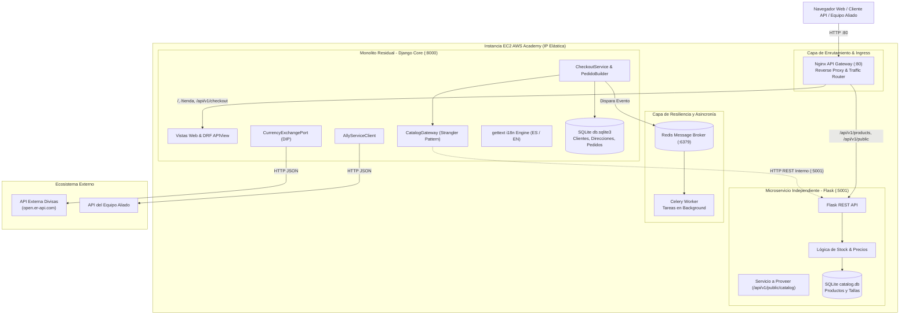
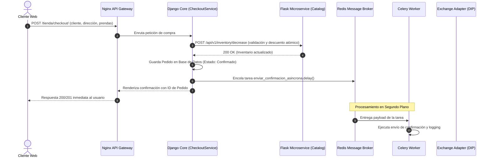

# Documento de Arquitectura de Software 2026-I
## Entrega No. 2: Migración a Microservicios, Integración y Resiliencia
**Proyecto:** E-Commerce Bersaj  
**Profesor:** Nicolás Ramírez Vélez  
**Equipo:** Adyuer De Jesus Ojeda Badel, Alejandro Cadavid Osorio, Santiago Lafont Díaz  

---

## 1. Visión General del Sistema y Strangler Pattern

En esta segunda entrega, el monolito desarrollado en Django evoluciona hacia una **arquitectura híbrida orientada a microservicios** mediante la aplicación del **Strangler Fig Pattern (Patrón Estrangulador)**.

La lógica del **Catálogo de Productos e Inventario** ha sido estrangulada y extraída hacia un microservicio independiente en **Flask**, con su propio almacén de datos relacional (`catalog.db`). El monolito en Django ahora orquesta las compras mediante un Gateway HTTP interno (`CatalogGateway`) con inversión de dependencias.

---

## 2. Descripción de Componentes Arquitectónicos

### 2.1. API Gateway (Nginx)
Configurado como punto de entrada único (*Reverse Proxy*):
* Enruta el tráfico hacia el microservicio en Flask (`/api/v1/products`, `/api/v1/public/catalog`, `/api/v1/inventory`).
* Enruta el tráfico hacia Django Core para la interfaz de usuario, checkout y administración (`/`, `/tienda/`, `/checkout/`).
* Aplica control de timeouts y trazabilidad mediante headers `X-Forwarded-*`.

### 2.2. Microservicio de Catálogo e Inventario (Flask)
* Aislamiento total de dominio: gestiona productos, tallas, verificación de existencias y descuento atómico.
* **Servicio a Proveer (Requerimiento 2.3):** Expone `GET /api/v1/public/catalog` con los productos, precios y disponibilidad en formato JSON estructurado para el consumo de equipos aliados.

### 2.3. Resiliencia y Comunicación Asíncrona (Celery + Redis)
* Para evitar que las llamadas a servicios externos o el envío de correos bloqueen el ciclo de vida de la petición HTTP, `CheckoutService` delega la confirmación a `store.tasks.enviar_confirmacion_asincrona` encolada en **Redis**.
* El contenedor `celery_worker` procesa los eventos en segundo plano de manera tolerante a fallos.

### 2.4. Patrón Adapter e Inversión de Dependencias (DIP)
* Para cumplir el Requerimiento 2.3, el sistema define la abstracción `CurrencyExchangePort`.
* `OpenExchangeRateAdapter` consume la API pública en tiempo real de tipo de cambio USD/COP.
* `MockExchangeRateAdapter` permite ejecutar pruebas deterministas sin dependencia de red.
* La capa de presentación consume el puerto sin conocer los detalles de implementación de la API externa.

### 2.5. Consumo del Servicio del Equipo Aliado
* `AllyServiceClient` consume el endpoint público del equipo aliado y renderiza su catálogo en la vista `/tienda/aliado/`. Incluye fallback resiliente si el servidor aliado no se encuentra disponible.

### 2.6. Internacionalización Completa (i18n con gettext)
* Soporte bilingüe (Español / Inglés).
* Cero textos quemados: todos los mensajes de validación, respuestas y etiquetas de UI utilizan `gettext` (`_()`).
* Compilación binaria de catálogos `.mo` mediante script multiplataforma `compile_po.py`.

---

## 3. Diagrama de Secuencia: Checkout Asíncrono con Strangler Pattern

---

## 4. Rúbrica ABET y Verificación de Requerimientos

| Criterio | Peso | Implementación en Bersaj | Estado |
|---|:---:|---|:---:|
| **Correcciones E1** | 10% | Modelos, Builder, Service Layer desacoplado y validaciones SRP refinadas. | Cumplido |
| **Arquitectura** | 10% | Diagramas completos C4/Mermaid (AWS, Nginx, Flask, Redis, Celery, DB) en este documento. | Cumplido |
| **Servicios** | 30% | Endpoint a proveer (`/api/v1/public/catalog`), consumo de aliado (`/tienda/aliado/`) y Adapter con DIP (`CurrencyExchangePort`). | Cumplido |
| **Infraestructura** | 30% | Docker Compose orquestando 5 servicios + Nginx API Gateway + Guía de despliegue en AWS EC2 con IP Elástica. | Cumplido |
| **Resiliencia y UX** | 20% | Broker Redis/Celery para eventos en fondo, soporte i18n gettext (ES/EN) y UI interactiva Bootstrap 5. | Cumplido |
