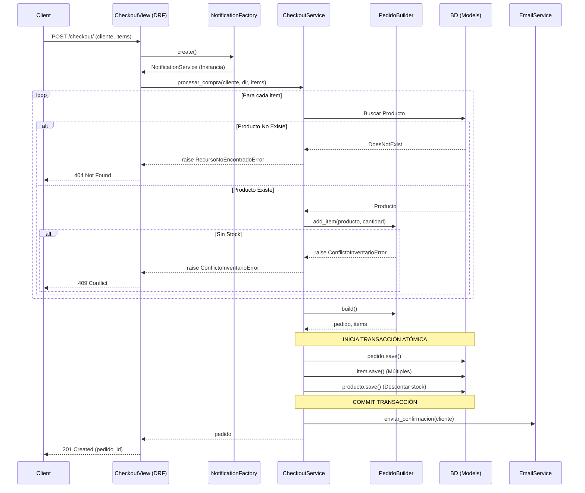

# Wiki Técnica: E-Commerce Bersaj

## 1. Justificación de la Estructura de Carpetas

La arquitectura del proyecto sigue el principio de **Separación de Responsabilidades (Separation of Concerns)**, utilizando un enfoque orientado al dominio.

- `store/domain/`: Contiene la lógica de negocio central. Aunque se apoya en los modelos de base de datos (`store.models`) para la definición de entidades, las reglas y validaciones complejas (como cálculos de stock y orquestación de creación) residen aquí.
  - `pedido_builder.py`: Implementa el patrón *Builder* para orquestar la compleja creación de pedidos, validando reglas de negocio estables (stock, cálculos) sin acoplarse a lógicas de HTTP.
  - `excepciones.py`: Define errores semánticos (`RecursoNoEncontradoError`, `ConflictoInventarioError`) para que la capa de aplicación pueda comunicar fallos sin acoplarse a respuestas HTTP.
- `store/infra/`: Contiene adaptadores para dependencias externas. En este caso, agrupa la lógica de envío de correos, abstrayéndolo a través del patrón *Factory* y una interfaz (`notification_interface.py`).
- `store/services.py`: **Capa de Aplicación (Service Layer)**. Actúa como orquestador. Coordina el acceso a datos, el dominio (Builder), y la infraestructura (Notificaciones), gestionando además las transacciones atómicas de base de datos.
- `store/views.py`: **Capa de Presentación**. Restringida exclusivamente a desempaquetar peticiones HTTP, delegar el trabajo al servicio, y empaquetar la respuesta HTTP. Aquí también se actúa como *Composition Root* inicializando el Factory.

## 2. Diagrama de Secuencia: Flujo de Checkout

A continuación se describe el flujo del caso de uso más complejo (`procesar_compra`):

## 3. Preparación para API Gateway (Escalabilidad)

El diseño actual del sistema prepara el terreno de manera natural para integrarse con un **API Gateway** por las siguientes razones:

1. **Agnosticismo HTTP en Servicios:** Los flujos de negocio en `services.py` no reciben un objeto `Request` ni retornan un `Response`. El servicio espera estructuras nativas de Python (strings, ints, listas). Si mañana el tráfico llega por gRPC, GraphQL o colas asíncronas desde el API Gateway, la lógica de negocio se reutiliza 100%.
2. **Excepciones Traducibles:** Las excepciones de dominio (como `RecursoNoEncontradoError`) son independientes del framework. Permiten al API Gateway o microservicio de presentación centralizar el manejo de errores y traducirlos a los códigos estándar de forma uniforme.
3. **Manejo Centralizado de Infraestructura:** Al abstraer dependencias mediante Factories, el sistema puede cambiar fácilmente implementaciones (ej. usar Kafka en producción y Mock en local) sin alterar el core del negocio, vital al escalar detrás de un Gateway.
