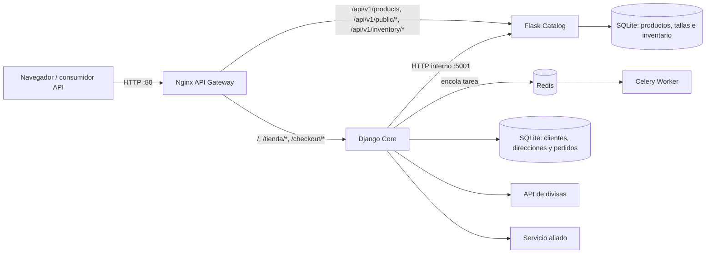

# Arquitectura

## Vista general

Nginx es el punto de entrada HTTP. Enruta la interfaz y el checkout hacia Django, y las rutas de catálogo e inventario hacia Flask. Django coordina los pedidos y utiliza Redis/Celery para delegar tareas de notificación.

## Componentes y responsabilidades

- **Nginx (`nginx/nginx.conf`):** proxy inverso, headers `X-Forwarded-*`, timeouts y rutas del gateway.
- **Django (`ecommerce/`, `store/`):** interfaz, API de checkout y datos del cliente y del pedido.
- **Flask (`services/catalog_service/`):** catálogo, tallas, consulta de stock, descuento de inventario y endpoint público.
- **Redis y Celery:** transporte y ejecución de tareas en segundo plano.
- **SQLite:** persistencia separada para el núcleo Django y para el catálogo Flask.

## Flujo de compra

1. Django valida cliente, dirección y prendas recibidas.
2. `CheckoutService` delega la construcción y las reglas del pedido a `PedidoBuilder`.
3. `CatalogGateway` consulta talla, precio y disponibilidad en Flask.
4. Django persiste el pedido y solicita el descuento de inventario al microservicio.
5. La confirmación se encola en Redis y la procesa Celery.

## Patrones aplicados

| Patrón | Aplicación |
|---|---|
| Strangler Fig | Extracción del catálogo e inventario hacia Flask; Django accede mediante `CatalogGateway`. |
| Builder | `PedidoBuilder` valida y construye pedidos paso a paso. |
| Service Layer | `CheckoutService` coordina dominio, persistencia e infraestructura. |
| Adapter y DIP | `CurrencyExchangePort` desacopla el sistema de la API de divisas. |
| Factory e inyección de dependencias | Selección de adaptadores de moneda y servicios de notificación. |

## Integraciones

`OpenExchangeRateAdapter` consulta `open.er-api.com` para obtener la tasa USD/COP; existe un adaptador mock para pruebas y una tasa de respaldo ante fallos de red. `AllyServiceClient` consulta el endpoint público configurado para el aliado y dispone de respuesta de respaldo.

La descripción detallada y los diagramas C4 están en [`ARCHITECTURE.md`](../ARCHITECTURE.md).
